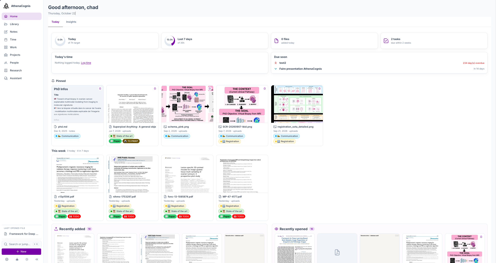
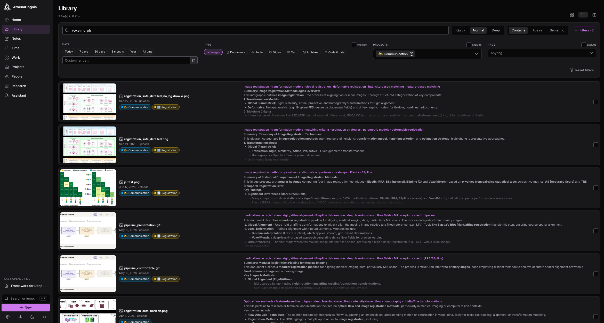
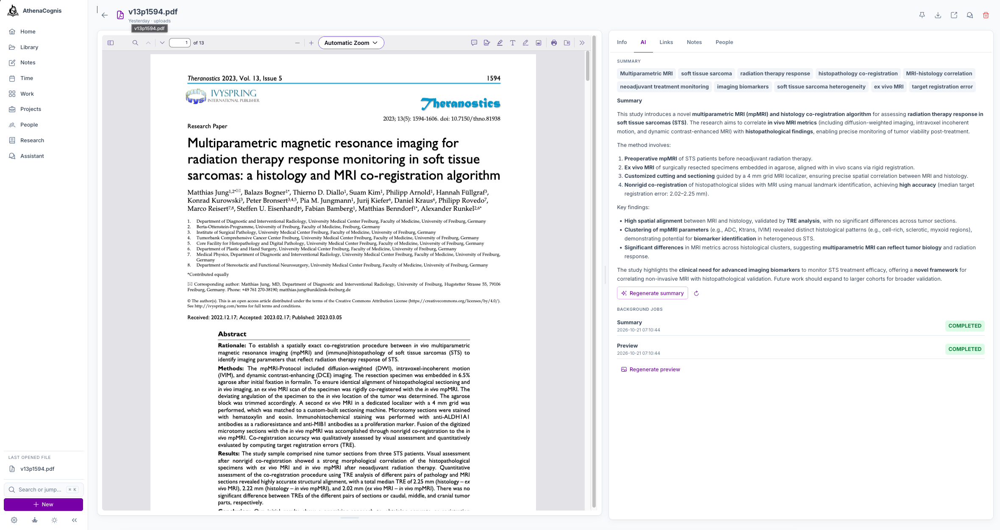
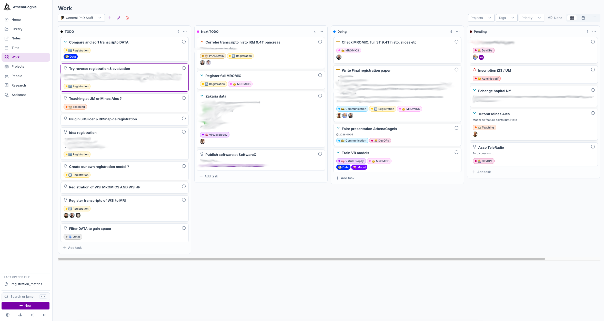
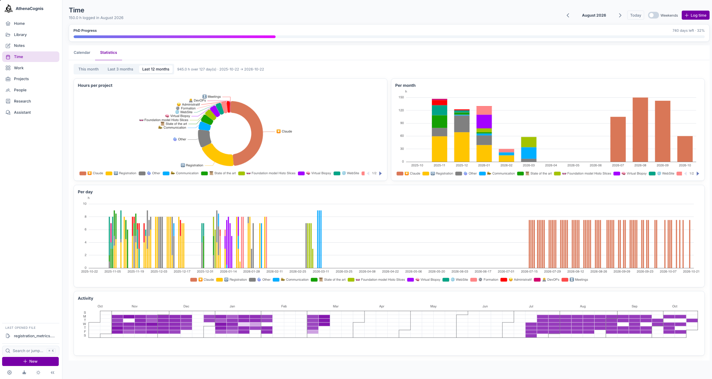
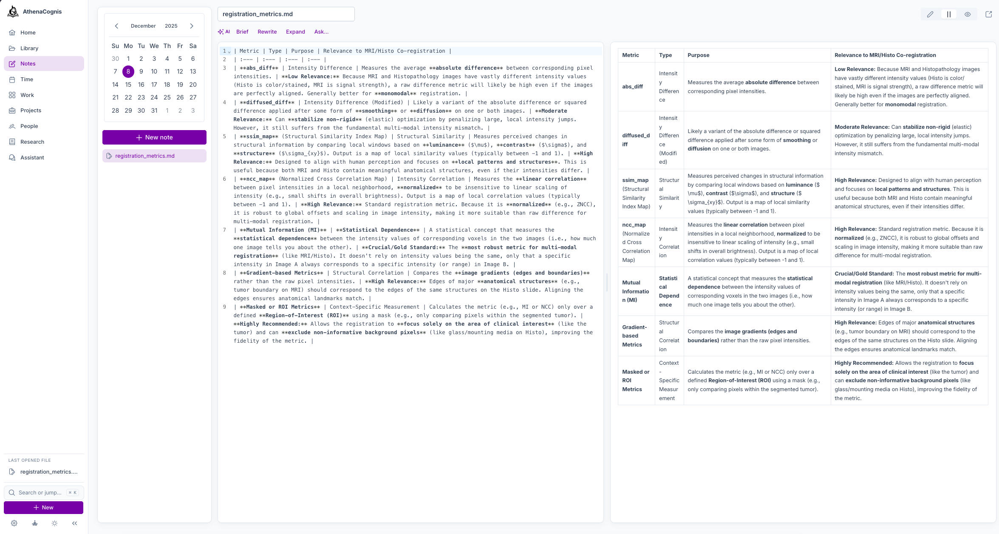
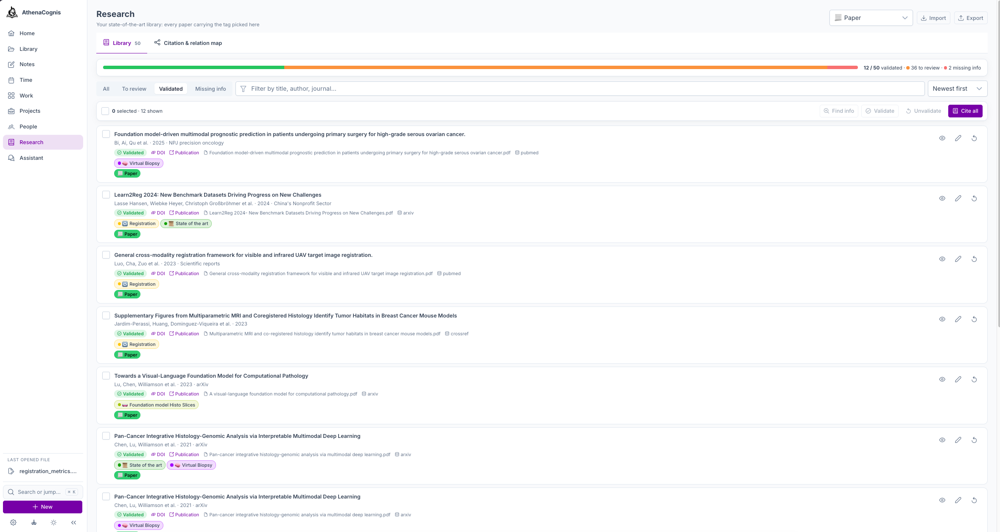
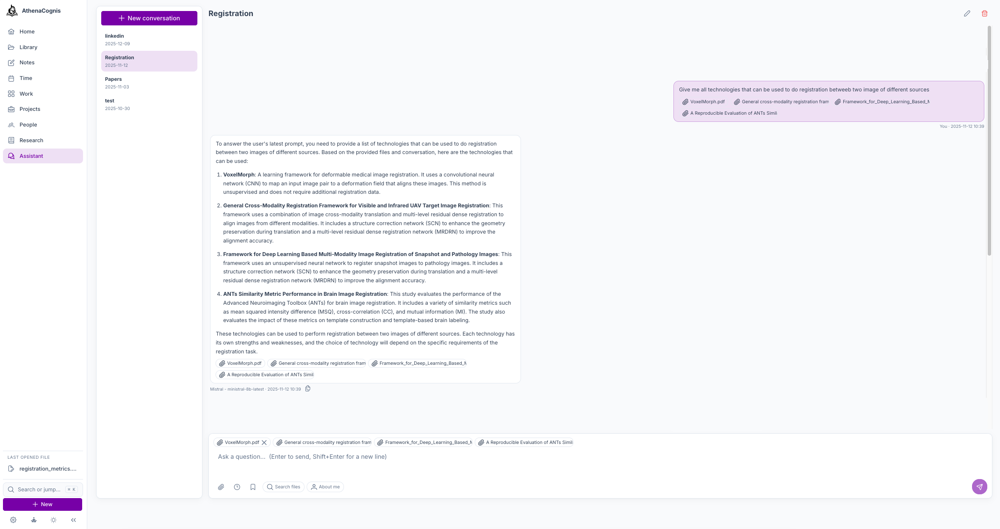

# AthenaCognis

<p align="center">
  
  
  
  
  
  
  
  
  <br/>
  
  
  
  
  
  <br/>
  
  
  
  
  
  
  <br/>
  
  
  
  
</p>

**AthenaCognis** is a self-hosted, AI-powered document management and knowledge assistant.
Drop any file in, and it is summarised, OCR'd or transcribed, searchable and linked to your projects, people,
tasks, time and research papers — all in one web app that keeps your data on your own machine.

<picture>
  <source media="(prefers-color-scheme: dark)" srcset="screenshots/01-home-today-dark.png">
  
</picture>

**→ Want to try it now? Jump to [Quick start](#-quick-start) (one double-click on macOS, Windows and Linux).**

- [A day with AthenaCognis](#-a-day-with-athenacognis)
- [Quick start](#-quick-start)
- [Features in detail](#-features-in-detail)
- [AI providers](#-ai-providers)
- [Architecture](#%EF%B8%8F-architecture)
- [Configuration](#%EF%B8%8F-configuration)
- [Why I built it](#-why-i-built-it)

## 🗺️ A day with AthenaCognis

All screenshots are in [`docs/screenshots`](screenshots).

### 1. Start from Home

Home answers "where am I?": hours logged today and this week against your target, tasks due soon, pinned
files, what you added this week and what you opened recently. The **Insights** tab turns the whole library
into numbers: files per type, project and tag, summaries, links and disk usage.

### 2. Capture anything

Drop files anywhere in the window, press <kbd>u</kbd>, or use **+ New**. Each upload gets a date, a project
and tags; names never overwrite an existing file. Press <kbd>v</kbd> to record a voice memo: it keeps
recording while you navigate and lands in the library ready for transcription.

In the background, AthenaCognis then extracts text (OCR), describes images, transcribes audio and video,
writes a summary with keywords and builds a preview — with a local model or the cloud provider you chose.

### 3. Find it again

The **Library** searches file names, your notes, summaries and, in deep mode, full document content.
Results stream in as files are examined. Filter by date, type, project and tag (include or exclude), switch
between cards, list and table, and select files for bulk actions.



Click a file to peek at it without leaving the results: preview, summary, projects, tags, people, location
and notes, all editable in place.

### 4. Read and understand

The viewer renders PDF, images, video, audio, Markdown, HTML, SVG, code, spreadsheets, Word, PowerPoint,
archives and notebooks. The inspector beside it holds the AI summary and keywords, OCR or transcription,
links to related files, your notes and the people involved.



Files are linked to each other by hand or by the AI (it scores similarity against candidates you pick), and
the **Links** tab draws the graph around the current file.

### 5. Organise the work

**Work** holds your boards: drag tasks across columns, set priority, dates, project, tags, people and
dependencies, then switch to the calendar or timeline view to see what is late.



Each **project** is a hub: overview and TODO, its files (with their summaries), the time spent on it, its
people and its tasks. **People** keeps your contacts with photo, details, notes and every file they are
linked to.

### 6. Track your time

Log what you did (project, start, duration, place, attendees). The month grid shows hours and files per
day against your daily target, the day drawer lists entries and files, and **Statistics** breaks hours down
by project and period. An optional progress banner tracks a long goal, like a PhD.



### 7. Write

**Notes** are dated Markdown files with a live preview and autosave. The AI assistant (brief, rewrite,
improve, or your own prompt) is available in every text area of the app.



### 8. Build your state of the art

Tag your papers and **Research** turns them into a bibliography: metadata is found on CrossRef, PubMed,
arXiv, OpenAlex and GROBID, then reviewed field by field. Cite in APA, Vancouver or BibTeX, import and
export Zotero RIS/BibTeX with PDFs, and explore the citation and AI relation map.



### 9. Ask the assistant

Chat with your documents: attach files and time entries as context, use presets for recurring requests
(report, review, newsletter…), toggle retrieval over the whole library, stop and retry answers.



### 10. Move fast, tune everything

<kbd>⌘K</kbd> / <kbd>Ctrl K</kbd> opens the command palette (pages, files, actions); <kbd>/</kbd> searches,
<kbd>g</kbd> + letter navigates. **Settings** is one searchable page: appearance, AI routing per task,
provider keys, Ollama models, assistant, processing, background jobs, tags and telemetry.

## 🚀 Quick start

### Prerequisites

- [Docker](https://docs.docker.com/engine/install/) and [Docker Compose](https://docs.docker.com/compose/install/)
- At least **8 GB RAM** allocated to Docker (Docker Desktop → Settings → Resources)
- A folder on your machine for persistent data

> **Note:** a GPU is optional. The app runs on CPU alone; local AI tasks (OCR, transcription,
> summarisation) are simply slower.

### Double-click launchers

The easiest way. Double-click the launcher for your OS at the repository root:

| File | Platform |
|------|----------|
| `start.command` | macOS |
| `start.bat` | Windows |
| `start.sh` | Linux |

1. If Docker isn't installed, it opens the Docker download page for you.
2. If `.env` doesn't exist yet, it asks a few questions (project name, data folder, ports, database
   password — press Enter to accept the defaults shown) and writes `.env` for you.
3. It starts AthenaCognis detached (`docker compose up -d`).
4. It waits for the app to respond and opens it in your browser. If it doesn't come up, it tells you
   to check your `.env` (bad `DATA_PATH`, a port already in use, etc.) and the container logs.

Closing the window does **not** stop AthenaCognis — it keeps running in the background; stop it with
`./down.sh` or `docker compose down`.

> **Linux note:** most file managers won't run a `.sh` file on double-click until it is executable.
> Right-click `start.sh` → Properties → Permissions → "Allow executing file as program" (varies by desktop
> environment), or run `chmod +x start.sh` once from a terminal.

### From a terminal

There are two ways to run AthenaCognis:

- **Docker Hub images** — just a `docker-compose.yml` and `.env`, no source needed. See [DEPLOYMENT.md](DEPLOYMENT.md).
- **Clone & build from source** — steps below.

```bash
git clone https://github.com/ChadEstoupStreiff/athenacognis.git
cd athenacognis
cp .env_ex .env     # then fill in the values, see Configuration
./up.sh             # build and start
```

Open `http://localhost:<FRONT_PORT>`. Stop with `./down.sh`.

**Optional — a local LLM:** in **Settings → Ollama**, enter a model name (e.g. `llama3.2:8b`) and pull it.
Browse models at [ollama.com/library](https://ollama.com/library).

## 📚 Features in detail

### 📂 Documents
- **Upload anywhere**, drag-and-drop, `u` shortcut or `/upload` link, with date, project and tags per file; conflict-safe naming
- **Date-organised storage**, files stored under `YYYY-MM-DD/subfolder/`
- **Three display modes**, cards, list and table, with thumbnails or text snippets
- **Viewer** for PDF, images, Markdown, HTML and SVG (rendered or source), code, audio, video, CSV, spreadsheets, Word, PowerPoint, ZIP trees and Jupyter notebooks
- **File operations**, rename, move (date/subfolder), delete, download, pin; bulk actions on selections
- **Sandboxed HTML**, scripts in uploaded HTML are blocked unless you choose "Run scripts"

### 🔍 Search
- **Three depths:** ⚡ **fast** (file names and notes), 🔍 **normal** (adds AI summaries and keywords), 🧠 **deep** (full content)
- **Streaming results**, files appear as they are examined, with live progress
- **Smart normalisation**, without special characters in the query, punctuation and separators are ignored — `UNet` finds `U-Net`, `u_net`, `U:Net`
- **✨ Semantic boost**, a second pass with `sentence-transformers` embeddings finds conceptually related files even without shared words; embeddings are computed lazily and cached
- **Similarity threshold**, configurable in Settings (default 0.4)
- **Filters**, date range, type, project and tag, each with include/exclude; kept in the URL so searches can be bookmarked
- **ZIP download** of a selection, entries named `<date>_<original_filename>`

### 🧠 AI extraction
- **Summaries and keywords**, stored per file and used by normal and deep search
- **OCR**, PaddleOCR extracts text from images
- **Image captions**, local BLIP or Ollama vision, or cloud vision models
- **Transcription**, local Faster-Whisper (tiny → large-v3) or OpenAI/Groq APIs
- **Per-feature switches**, enable or disable automatic OCR, transcription, summaries and previews
- **Background jobs**, a live queue with status per worker (the runner in the sidebar moves while jobs are busy)

### 🔗 Links between files
- **Manual links** with a strength and a comment
- **AI auto-link**, scores semantic similarity against candidates you pick and proposes links you can adjust
- **Graph**, interactive force-directed graph of the links around a file; click a node to open it

### 📋 Tasks
- **Multiple boards** with colour-coded, reorderable columns and drag-and-drop
- **Tasks**, title, Markdown description, start and due dates, priority (💡 idea, 🟢 low, 🟡 medium, 🟧 high, 🟥 critical, 🐞 bug), project, tags, people, dependencies
- **Three views**, board, calendar and timeline (incoming vs overdue)
- **Filters** by project, tag and priority across views

### 📝 Notes
- **Dated Markdown notes** with live preview and autosave
- **AI writing assistant** on every text area, with presets and custom prompts
- **Per-file notes**, searched by every search depth
- **Markdown everywhere**, summaries, descriptions, comments and chat messages are rendered

### 🗂️ Projects and 👤 people
- **Projects**, name, description and colour; hub with overview, notes, TODO checklist, files, time, people and tasks
- **Contacts**, name, email, phone, company, role, description, photo (compressed to 256 × 256), notes, linked files, projects and tags
- **Tags**, colour-coded, shared by files, tasks, chat context and the research library

### 📅 Time
- **Time entries** with project, date, start, duration, description, location and attendees
- **Month grid** with hours and files per day, and day status against your target (±1 h tolerance)
- **Progress banner**, optional gradient bar for a long goal with title, dates and colours
- **Statistics**, hours by project and by day, week or month over any range

### 📃 Research
- **SOTA tag**, any tag can mark your paper corpus
- **Metadata lookup** on CrossRef, PubMed, arXiv and OpenAlex, plus GROBID extraction from the PDF, reviewed field by field
- **Validation tracking** per paper
- **Citations** in APA, Vancouver and BibTeX
- **Zotero import/export**, RIS and BibTeX, with PDFs
- **Citation & AI relation map**, with timeline layout and shared references outside the library

### 💬 Assistant
- **Sessions** with full history
- **Context**, attach files (summary, OCR, transcription) and time entries
- **Presets**, configurable one-click prompts
- **Live answers**, streamed, with stop and retry
- **Retrieval toggle**, search the library to ground answers
- **Your profile**, optional description injected in the system prompt

## 🤖 AI providers

Each task selects its provider and model independently in **Settings → AI routing**. Cloud providers need
an API key in **Settings → Providers & keys** (stored in the database, not in `.env`).

| Task | Local | Cloud |
|------|-------|-------|
| Chat | Ollama (any model) | Mistral, OpenAI, Gemini, Claude |
| Summarisation | Ollama | Mistral, OpenAI, Gemini, Claude |
| Text rewriting | Ollama | Mistral, OpenAI, Gemini, Claude |
| Auto-link | Ollama | Mistral, OpenAI, Gemini, Claude |
| Semantic search embeddings | `all-MiniLM-L6-v2` (local, CPU) | — |
| OCR (text extraction) | PaddleOCR | — |
| Image caption / vision | Local BLIP, Ollama vision | Mistral Pixtral, GPT-4o / GPT-4.1, Gemini Vision, Claude |
| Transcription | Faster-Whisper (tiny → large-v3) | OpenAI Whisper API, Groq (whisper-large-v3 / turbo) |

| Provider | Models |
|----------|--------|
| Ollama | Any locally pulled model (e.g. `llama3.2:1b`, `llama3.2:8b`, `llama3.2:70b`, …) |
| Mistral | ministral-3b, ministral-8b, mistral-small, mistral-medium, mistral-large, magistral-small, magistral-medium |
| OpenAI | gpt-3.5-turbo, gpt-4, gpt-4o, gpt-4o-mini, gpt-4.1, gpt-4.1-mini, gpt-4.1-nano |
| Gemini | gemini-2.0-flash-lite, gemini-2.0-flash, gemini-2.5-flash-lite, gemini-2.5-flash, gemini-2.5-pro |
| Claude | claude-haiku-4-5, claude-sonnet-4-6, claude-opus-4-8, claude-fable-5 |
| Groq | whisper-large-v3, whisper-large-v3-turbo *(transcription only)* |

## 🏗️ Architecture

| Service | Image | Purpose | Host port |
|---------|-------|---------|-----------|
| `front` | Custom (nginx + Angular 21 / PrimeNG build) | Web UI; proxies `/api` to the backend, serves files read-only; see [front/README.md](../front/README.md) | `FRONT_PORT` |
| `back` | Custom (FastAPI) | REST API, background AI workers, file management | `BACK_PORT` |
| `back_db` | `mariadb:10.6` | Metadata, tasks, links, notes and settings | (internal) |
| `ollama` | `ollama/ollama` | Local LLM inference; models in `DATA_PATH/ollama` | (internal) |
| `grobid` | `grobid/grobid` | Paper metadata and bibliography extraction | (internal) |
| `pma` | `phpmyadmin/phpmyadmin` | Database admin UI | `PMA_PORT` |

**Background workers** (threads in `back`): `OCRManager` (OCR and image captions), `TranscriptionManager`,
`SummarizeManager`, `PreviewManager` (image, text, archive and video previews at low/medium/high quality),
`ChatManager` (streamed answers) and `EmbeddingManager` (cached embeddings for semantic search).

| Layer | Technology |
|-------|-----------|
| Frontend | Angular 21, PrimeNG 21, nginx |
| Backend | Python 3, FastAPI, SQLAlchemy |
| Database | MariaDB 10.6 |
| Search | Substring matching with normalisation, streamed as NDJSON; `sentence-transformers` semantic pass |
| AI | Ollama, OpenAI, Mistral AI, Google Gemini, Groq, Anthropic Claude, PaddleOCR, BLIP, Faster-Whisper |
| Deployment | Docker, Docker Compose |

<details>
<summary><b>📁 Supported file types</b></summary>

| Category | Formats |
|----------|---------|
| Documents | PDF, DOCX, PPTX, TXT, MD, HTML, EPUB |
| Spreadsheets / data | CSV, XLSX, JSON, JSONL, YAML, TOML |
| Images | JPEG, PNG, WebP, GIF, BMP, TIFF, HEIC, SVG |
| Audio | MP3, WAV, OGG, FLAC, AAC, WMA, M4A |
| Video | MP4, AVI, MOV, MKV, WebM, WMV, FLV, MPEG |
| Code | Python, JavaScript, TypeScript, Go, Rust, Java, C, C++, PHP, Ruby, Swift, Kotlin, R, SQL, Shell, and more |
| Notebooks | Jupyter (.ipynb) |
| Archives | ZIP, TAR, GZ, BZ2, TGZ, 7Z, RAR |

</details>

> **Network:** the app has no login. Keep it on a trusted network; `BACK_PORT` and `PMA_PORT` are
> unauthenticated too. See [DEPLOYMENT.md](DEPLOYMENT.md#network-exposure).

## ⚙️ Configuration

All core configuration lives in `.env`:

| Variable | Required | Description | Example |
|----------|----------|-------------|---------|
| `PROJECT_NAME` | ✅ | Docker Compose project name | `athenacognis` |
| `USER_NAME` | ✅ | Your name, shown in the Home greeting | `chad` |
| `DATA_PATH` | ✅ | Absolute host path for all persistent data (files, database, models, caches) | `/data/athenacognis` |
| `BACK_PORT` | ✅ | Host port of the FastAPI backend | `8400` |
| `FRONT_PORT` | ✅ | Host port of the web app | `8401` |
| `PMA_PORT` | ✅ | Host port of phpMyAdmin | `8402` |
| `DATABASE_PASSWORD` | ✅ | MariaDB root password | `supersecret` |
| `TELEMETRY_SERVER_URL`, `TELEMETRY_DASHBOARD_URL` | ☑️ optional | Anonymous usage statistics (opt-in, once a day) | |

## 💡 Why I built it

I'm currently doing a PhD after obtaining a DevOps engineer degree. Before that, I was an AI & DevOps intern at a startup, my managers were genuinely happy with my output, but they often struggled to follow what I was actually working on. The problem wasn't the work itself; it was me. I've never been great at writing reports, summarising progress, or communicating what I've built.

Starting a PhD made that gap feel even more urgent. Research demands exactly the kind of structured communication I'd always avoided. So I did what any developer would do: I built a tool to solve the problem.

AthenaCognis started as a personal system to organise and track my own work, documents, tasks, notes, time, research papers, in one place, with AI doing the heavy lifting on summaries and reports so I don't have to. What began as a workaround for my own weaknesses turned into something genuinely powerful that saves me a significant amount of time and has noticeably improved how I communicate my work. It lets me focus on what I actually enjoy: research and building things.

I've open-sourced it because the problem it solves isn't unique to me, and if it ends up being useful to other researchers and engineers, that's a nice bonus. (A widely-used open-source tool that supports scientific work also makes for a pretty solid PhD contribution, not going to lie.)

You can visit my website for more of me: [https://chades.fr](https://chades.fr) :)

## 🎓 License

MIT License © Chad Estoup-Streiff
